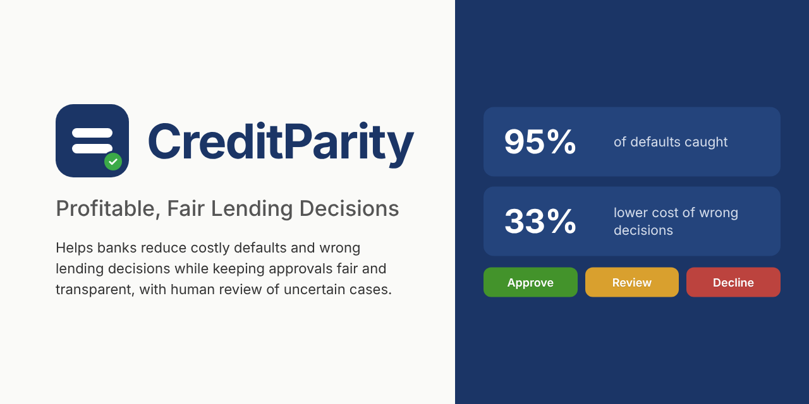

# CreditParity: Profitable, Fair Lending Decisions

> **Live app: [creditparity.streamlit.app](https://creditparity.streamlit.app)**

CreditParity is a credit risk scoring prototype for a bank's retail customers that aims to be both **profitable** and **demonstrably fair**. 

**How it works:** A credit analyst enters a single loan application (or uploads several as a CSV) and receives a default probability, a rating class, a decision zone and an explanation of the main drivers.




## Business case

For every loan application, a bank decides whether to approve it. Both possible errors cost money, but not equally:

- **Missed default (false negative):** a defaulter is approved, and the bank loses a large part of the loan.
- **Rejected good customer (false positive):** the bank only loses the interest margin.

We assume that a missed default costs **5 times** as much as a rejected good customer (the classic cost matrix for the German Credit data). This ratio is an assumption and can be changed.

Instead of a simple approve/reject decision, CreditParity uses a **human-in-the-loop policy with three zones**:

| Zone | Meaning |
|---|---|
| 🟢 Green – auto-approve (PD < 0.13) | Low default probability, approved automatically |
| 🟡 Yellow – manual review (0.13 ≤ PD < 0.62) | Uncertain cases: a credit analyst decides, supported by a SHAP explanation. This is the only manual workload. |
| 🔴 Red – decline recommended (PD ≥ 0.62) | The system declines and gives the customer a SHAP-based explanation; the customer can request a human review |

### Decision zones

Clear cases are handled automatically and uncertain cases go to a credit analyst. This reflects the human oversight required for high-risk AI systems such as credit scoring (EU AI Act) and keeps the analyst workload manageable.

- **Lower boundary (approve):** the cost-optimal threshold based on a 5:1 cost matrix.
- **Upper boundary (decline):** the lowest threshold at which at least 80% of automatic declines are actual defaults.

Each application also gets a **risk rating** (A < 5%, B 5–15%, C 15–35%, D 35–70%, E ≥ 70% default probability). The rating describes the applicant's risk; the zone describes how the bank handles the application. Changing the bank's settings can change the zone, but never the rating.

### Final model: the CreditParity model

A logistic regression trained with **partial reweighing** (strength 0.5), so that it learns only part of the group differences in default rates. **Gender and nationality are not model inputs.** Age stays in the model as a partial correction for other features that indirectly reveal age, such as employment length.

With the CreditParity model, the cost of wrong decisions on the test set is **38% lower** than with a standard model at the usual 50% cut-off (436 vs. 700), and **96% of defaults are caught**. Automatic declines of creditworthy applicants aged 51+ **fall by more than half** compared with a model without age correction (16 vs. 40 of 83 on the training data).

### Age correction strength

In this synthetic dataset, older applicants default far more often than younger ones, and many features reveal age indirectly. A full age correction protects creditworthy older applicants almost completely, but it rates young applicants about four times riskier than their actual default rate (test set) and makes age the strongest risk factor for many of them. No correction does the opposite: it is the cheapest, but it automatically declines about half of the creditworthy applicants aged 51+. CreditParity uses a partial correction (strength 0.5). It roughly halves the age penalty for young applicants and lowers the cost of wrong decisions, while keeping the age gap clearly below that of an uncorrected model. The price is that some creditworthy older applicants are declined automatically: 16 of 83 on the training data, compared with 40 of 83 without correction. Age-related outcomes should therefore be monitored.

### The price of fairness

Compared with the standard model without fairness correction (model (a): all features, no reweighing), CreditParity costs 7% more (436 vs. 409) and sends more applications to manual review (52% vs. 42%). In return, the age gap for creditworthy applicants falls from 0.81 to 0.59, fewer good customers are declined automatically (25 vs. 43), and no score depends directly on gender or nationality.

We also tested a model that uses gender as an input. It almost removes the gender gap, but only by rating women as riskier than men with all other features equal. CreditParity chooses **equal treatment** instead and accepts a remaining gender gap of about 0.2 (0.21 on the test set, 0.25 out-of-fold), which works against men because of differences in other features.

## Data

- `data/german_credit_data_biased_training.csv`: IBM version of the German Credit dataset, **synthetic**, 5,000 applications, 20 features, no missing values
- Target: `Risk` (default = 1, about 33% of applications)
- Sensitive attributes: `Sex` (gender), `Age`, `ForeignWorker`

## Results so far

| Step | Notebook | Key result |
|---|---|---|
| 1–3 Business case, EDA, baseline | `notebooks/credit_risk_steps_1-3.ipynb` | Logistic regression on the test set: accuracy 0.80, recall 0.63, ROC AUC 0.87. Strong age effect in the data (default rate 7% for ages 19–25 vs. 78% for 51+). |
| 4 Model comparison | `notebooks/credit_risk_step_4_model_comparison.ipynb` | 5-fold CV on the training set: logistic regression ROC AUC **0.857**, tuned XGBoost 0.850, tuned random forest 0.848. Logistic regression is best in all 5 folds, so we keep the simple, explainable model. |
| 5 Thresholds and zones | `notebooks/credit_risk_step_5_thresholds_and_zones.ipynb` | CreditParity model, thresholds chosen on out-of-fold predictions of the training set. Lower boundary = cost-optimal threshold **0.13**; upper boundary **0.62** (≥ 80% of automatic declines are defaults). Test set: cost **700 → 436 (−38%)** vs. the default threshold 0.5, recall 0.63 → 0.96; 30% auto-approved, 52% manual review, 18% decline recommended (red-zone precision 86%, 25 good customers declined automatically). Comparison model (a): cost 409. |
| 6 Fairness | `notebooks/credit_risk_step_6_fairness.ipynb` | Model (a) declines 95–96% of creditworthy applicants aged 51+ vs. 14–17% of those aged 19–25 (Equal Opportunity Difference 0.80 out-of-fold). **Dropping sensitive features does not help** (EOD 0.82), because age can be reconstructed from other features (ROC AUC 0.90). **Reweighing with age as an input** reduces the age gap. A comparison of five reweighing strengths (0 to 1) shows that full reweighing overshoots for young applicants, so the CreditParity model uses **strength 0.5** (age gap 0.62 vs. 0.84 without correction, out-of-fold). Good customers aged 51+ declined automatically: 41 of 83 with (a), 16 of 83 with the CreditParity model. For gender, equal treatment and equal outcomes conflict on this data (models (c) and (e) as evidence); CreditParity chooses equal treatment. |
| 7 Explainability | `notebooks/credit_risk_step_7_explainability.ipynb` | Exact SHAP values for the logistic regression, aggregated to the input features. In the CreditParity model, **age is the fifth-strongest driver, with a negative coefficient** (ten years younger multiplies the odds of default by 1.62): it acts as a partial counterweight to the age proxies (e.g. long employment), so it is shown to analysts as "Age (fairness correction)". Gender and foreign worker status never appear. Some explanations are implausible because the data is synthetic (e.g. a negative checking balance lowers the risk). |
| 8 Saved model | `notebooks/credit_risk_step_8_save_model.ipynb` | `model/creditparity_bundle.joblib` holds the CreditParity model and the comparison model (a) as complete sklearn pipelines, the decision policy (0.13 / 0.62, 80% precision target, 5:1 costs) and the data for exact SHAP explanations; `model/policy.json` and `model/evaluation_data.csv` support the dashboard. Reloading the files in a separate process reproduces all 26 checked test-set values. |
| 9 Dashboard | `app.py` | Plain-language Streamlit app for bank staff (home page, check a single application, check several applications, bank settings, how it works). Loads the saved files from Step 8; its bank settings reproduce the Step 5/6 test results (e.g. 38% lower cost of wrong decisions than the default threshold of 0.5, 96% of defaults caught, 52% manual review, 4 of 21 good customers aged 51+ declined automatically). |

An initial analysis with IBM watsonx AutoAI selected an XGBoost pipeline by accuracy (79.6% on a 499-case holdout, but recall of only 53%). Our fair comparison on identical folds shows that this extra complexity does not pay off on this dataset.

## Limitations

1. **Synthetic data.** The dataset is synthetic and some relationships are implausible (e.g. a negative checking balance has the lowest default rate). Results may not transfer to real loan data. In this synthetic dataset, older applicants default far more often than younger ones (76% vs. 5% on the test set), the opposite of what is typical in real lending data, so the age correction works in an unexpected direction.

2. **Business assumptions.** The 5:1 cost ratio and the 80% precision target for automatic declines are assumptions, not estimates from real data. Both should be validated with the bank's risk and compliance teams before deployment.

3. **Manual review workload.** About half of all applications (52%) go to manual review. A higher precision target reduces wrongful automatic declines but increases this workload, so thresholds should be monitored and adjusted to the available analyst capacity. Cost figures do not include how analyst decisions change outcomes.

4. **Remaining fairness trade-offs.** The model does not use gender or nationality, but a gender gap of about 0.2 among good customers remains (0.21 on the test set, 0.25 out-of-fold), working against men. The age correction shifts predicted risk toward younger applicants: those aged 19–25 are rated about 2.7 times riskier than their actual default rate on the test set (13.8% vs. 5.1%). Most of them are routed to manual review rather than declined (1.4% of good customers aged 19–25 are declined automatically, out-of-fold). In turn, some creditworthy older applicants are declined automatically (16 of 83 on the training data). The correction strength of 0.5 is a judgment call and should be reviewed with real data.

5. **Legal review needed.** Age is used directly as a partial correction for hidden age bias, and gender and nationality are used to compute the training weights. Both, as well as the remaining gender gap, require legal review before real-world use.

6. **Explanations for analysts only.** Explanations are designed for credit analysts. Customer-facing explanations for automatic declines (GDPR Art. 22) are a next step.

## Repository structure

```
data/                       dataset
notebooks/                  one notebook per project phase (Google Colab compatible)
model/                      final and comparison pipelines, decision policy, evaluation data (Step 8)
app.py                      Streamlit app
assets/logo.svg             CreditParity logo (logo_on_dark.svg: white version for the navy sidebar)
.streamlit/config.toml      dashboard theme
requirements.txt            dashboard dependencies (used by Streamlit Cloud)
requirements-notebooks.txt  additional packages for the notebooks
docs/screenshots/           screenshots of the dashboard
AI_USAGE.md                 documentation of AI assistance
```

## The dashboard

`app.py` is a Streamlit app for bank staff without a technical background. It uses plain language; the technical details are documented in the notebooks and in this README.

- **Home:** Mission, a short overview of the sections and the logo (`assets/logo.svg`).
- **Check a single application:** One form for all application fields (gender and nationality are not asked for). Shows the chance of default, the risk rating (A–E), the recommendation (approve automatically, manual review, decline recommended), the main reasons for the result (exact SHAP values, shown without numbers; age is labelled "Age (fairness correction)") and a summary for the credit analyst in the manual review zone.
- **Check several applications:** Upload a CSV file (an example file can be downloaded in the app) and download the results.
- **Bank settings:** Two sliders: the chance of default below which applications are approved automatically, and the share of automatic declines that must be truly bad loans. Workload, cost of wrong decisions, bad loans caught and a fairness check by group update live on the 1,000 test applications. A reset button restores the recommended settings (13% and 80%). The comparison with model (a) (price of fairness) is documented in this README and the notebooks, not in the app.
- **How it works:** How recommendations are made, risk rating vs. recommendation, the fairness promise and the most important limitations in plain words.

Screenshots: [home](docs/screenshots/0_home.png) · [check a single application](docs/screenshots/1_check_a_single_application.png) · [check several applications](docs/screenshots/2_check_several_applications.png) · [bank settings](docs/screenshots/3_bank_settings.png) · [how it works](docs/screenshots/4_how_it_works.png)
