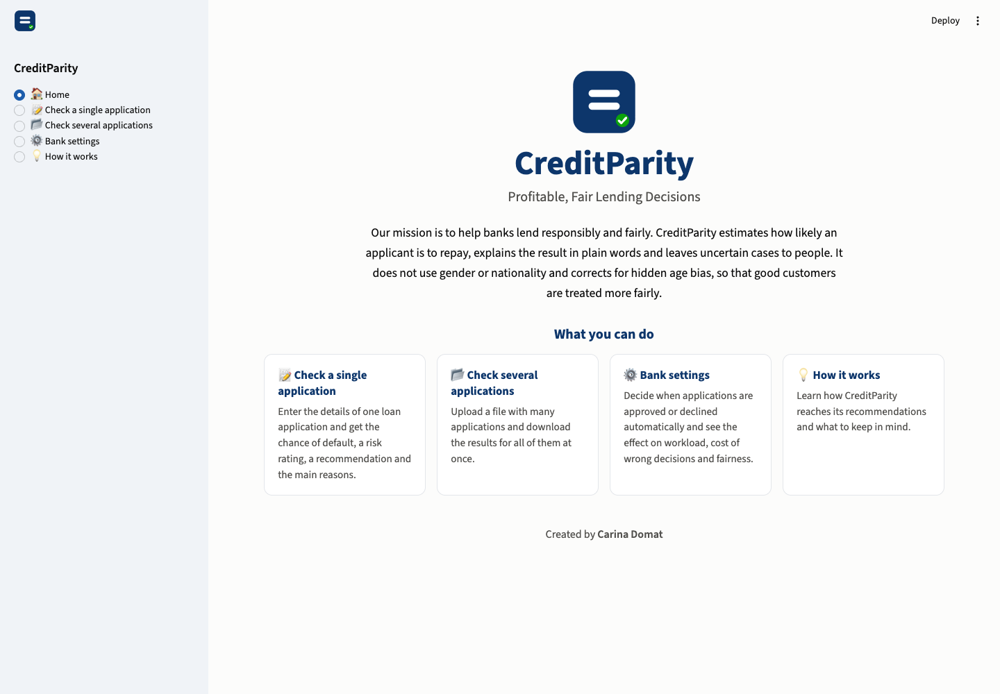

# CreditParity – Profitable, Fair Lending Decisions

[](https://creditparity.streamlit.app)

> **Live app: [creditparity.streamlit.app](https://creditparity.streamlit.app)**

CreditParity is a credit risk scoring prototype for a bank's retail customers that aims to be both **profitable** and **demonstrably fair**. The name refers to *Demographic Parity*, one of the fairness metrics we measure.

A credit analyst enters a single loan application (or uploads several as a CSV) and receives a default probability, a rating class, a decision zone and an explanation of the main drivers.




## Business case

For every loan application, a bank decides whether to approve it. Both possible errors cost money, but not equally:

- **Missed default (false negative):** a defaulter is approved, and the bank loses a large part of the loan.
- **Rejected good customer (false positive):** the bank only loses the interest margin.

We assume that a missed default costs **5 times** as much as a rejected good customer (the classic cost matrix for the German Credit data). This ratio is an assumption and can be changed.

Instead of a simple approve/reject decision, CreditParity uses a **human-in-the-loop policy with three zones**:

| Zone | Meaning |
|---|---|
| 🟢 Green – auto-approve (PD < 0.15) | Low default probability, approved automatically |
| 🟡 Yellow – manual review (0.15 ≤ PD < 0.71) | Uncertain cases: a credit analyst decides, supported by a SHAP explanation. This is the only manual workload. |
| 🔴 Red – decline recommended (PD ≥ 0.71) | The system declines and gives the customer a SHAP-based explanation; the customer can request a human review |

The zones are justified by **human oversight**, not by extra cost savings: the EU AI Act classifies credit scoring as a high-risk AI system that requires effective human oversight, and GDPR Art. 22 gives applicants the right to human intervention and to contest automated decisions. At the same time, the zones keep the analyst workload manageable by handling clear cases automatically.

**Boundaries.** The lower boundary is the cost-optimal threshold (5:1 cost matrix). The upper boundary is the lowest threshold at which at least 80% of automatic declines are actual defaults (precision rule). Both are chosen on cross-validated predictions of the training data.

**Rating and zone.** Each application also gets a rating on a fixed master scale (A < 5%, B 5–15%, C 15–35%, D 35–70%, E ≥ 70% default probability). The rating describes the applicant's risk and depends only on the default probability, while the zone describes how the bank handles the application and follows the policy, so changing the policy can change the zone but never the rating.

**Final model (d).** A logistic regression trained with **reweighing** on age group, gender and foreign worker status, so that it does not learn the group differences in default rates. **Gender and foreign worker status are not model inputs**: no applicant's score depends directly on gender. `Age` stays as an input, as a correction for the many features that indirectly reveal age. The model with all features and no reweighing, (a), is kept as a comparison to show the price of fairness.

**Core message:** a simple, explainable model performs as well as a complex one. The real gain comes from catching more defaults with a cost-based threshold, combined with human judgment for uncertain cases. With the fair model, the weighted cost of wrong decisions (5:1 cost matrix) on the test set is still about **one third lower** than with the default threshold of 0.5 (467 vs. 700), while the age gap for creditworthy applicants drops from 0.81 to 0.37.

### The price of fairness

Compared with model (a), the fair model (d):
- has a **14% higher cost of wrong decisions** (467 vs. 409 on the test set), but still a **33% lower cost of wrong decisions** than the default threshold of 0.5 (700);
- sends more applications to manual review (**60% vs. 42%**);
- auto-approves more defaults (**17 vs. 14**);
- has a larger gender gap among good customers (0.17 vs. 0.11 on the test set), which works against men.

In return:
- **no creditworthy applicant aged 51+ is declined automatically** on the test set (0 of 21, vs. 8 of 21 with model (a); on the training data 1 of 83 vs. 41 of 83);
- the age gap for creditworthy applicants (EOD) falls from 0.81 to 0.37 (test set);
- no applicant's score depends directly on gender or foreign worker status.

### Equal treatment vs. equal outcomes for gender

We also tested model (c), which uses gender (the `Sex` column) as an input. It almost removes the gender gap (0.03 on the test set), but only because, with all other features equal, it rates women as riskier than men. Every model that scores men and women with the same features identically shows a gender gap of about 0.2 against men, because men in this dataset have less favorable values on other features. CreditParity chooses **equal treatment**: no direct gender-based treatment is a core principle.

## Data

- `data/german_credit_data_biased_training.csv`: IBM version of the German Credit dataset, **synthetic**, 5,000 applications, 20 features, no missing values
- Target: `Risk` (default = 1, about 33% of applications)
- Sensitive attributes: `Sex` (gender), `Age`, `ForeignWorker`

## Results so far

| Step | Notebook | Key result |
|---|---|---|
| 1–3 Business case, EDA, baseline | `notebooks/credit_risk_steps_1-3.ipynb` | Logistic regression on the test set: accuracy 0.80, recall 0.63, ROC AUC 0.87. Strong age effect in the data (default rate 7% for ages 19–25 vs. 78% for 51+). |
| 4 Model comparison | `notebooks/credit_risk_step_4_model_comparison.ipynb` | 5-fold CV on the training set: logistic regression ROC AUC **0.857**, tuned XGBoost 0.850, tuned random forest 0.848. Logistic regression is best in all 5 folds, so we keep the simple, explainable model. |
| 5 Thresholds and zones | `notebooks/credit_risk_step_5_thresholds_and_zones.ipynb` | Final model (d), thresholds chosen on out-of-fold predictions of the training set. Lower boundary = cost-optimal threshold **0.15**; upper boundary **0.71** (≥ 80% of automatic declines are defaults). Test set: cost **700 → 467 (−33%)** vs. the default threshold 0.5, recall 0.63 → 0.95; 30% auto-approved, 60% manual review, 10% decline recommended (red-zone precision 86%, 14 good customers declined automatically). Comparison model (a): cost 409. |
| 6 Fairness | `notebooks/credit_risk_step_6_fairness.ipynb` | Model (a) declines 95–96% of creditworthy applicants aged 51+ vs. 14–17% of those aged 19–25 (Equal Opportunity Difference 0.80 out-of-fold). **Dropping sensitive features does not help** (EOD 0.82), because age can be reconstructed from other features (ROC AUC 0.90). **Reweighing with age as an input** (final model (d)) cuts the age gap to 0.29. Good customers aged 51+ declined automatically: 41 of 83 with (a), 1 of 83 with (d). For gender, equal treatment and equal outcomes conflict on this data (models (c) and (e) as evidence); CreditParity chooses equal treatment. |
| 7 Explainability | `notebooks/credit_risk_step_7_explainability.ipynb` | Exact SHAP values for the logistic regression, aggregated to the input features. In the fair model, **age is the strongest driver, with a negative coefficient**: it acts as a counterweight to the age proxies (e.g. long employment), so it is shown to analysts as "Age (fairness correction)". Gender and foreign worker status never appear. Some explanations are implausible because the data is synthetic (e.g. a negative checking balance lowers the risk). |
| 8 Saved model | `notebooks/credit_risk_step_8_save_model.ipynb` | `model/creditparity_bundle.joblib` holds the final model (d) and the comparison model (a) as complete sklearn pipelines, the decision policy (0.15 / 0.71, 80% precision target, 5:1 costs) and the data for exact SHAP explanations; `model/policy.json` and `model/evaluation_data.csv` support the dashboard. Reloading the files in a separate process reproduces all 26 checked test-set values. |
| 9 Dashboard | `app.py` | Plain-language Streamlit app for bank staff (home page, check a single application, check several applications, bank settings, how it works). Loads the saved files from Step 8; its bank settings reproduce the Step 5/6 test results (e.g. 33% lower cost of wrong decisions than the default threshold of 0.5, 60% manual review, 0 of 21 good customers aged 51+ declined automatically). |

An initial analysis with IBM watsonx AutoAI selected an XGBoost pipeline by accuracy (79.6% on a 499-case holdout, but recall of only 53%). Our fair comparison on identical folds shows that this extra complexity does not pay off on this dataset.

## Limitations

- The dataset is **synthetic**. Some relationships are implausible, e.g. a negative checking account balance (`CheckingStatus = less_0`) has the lowest default rate. Results may not transfer to real loan data.
- The **5:1 cost ratio** is an assumption, not an estimate from real loss data.
- The 80% precision target for automatic declines is a business assumption. Before deployment it should be validated with the bank's risk and compliance teams. In operation, the thresholds should be monitored regularly and adjusted to the available analyst capacity: a higher target reduces wrongful automatic declines but increases the manual review workload.
- About 60% of applications go to manual review. The bank can adjust the precision target to balance analyst workload against wrongful automatic declines; thresholds should be monitored and adjusted to the available analyst capacity.
- The fair model auto-approves more defaults than model (a) (17 vs. 14 on the test set), because its lower boundary is higher (0.15 vs. 0.11) and it separates defaults from good customers less sharply.
- Cost figures assume that every application with a default probability ≥ 0.15 is declined. Analyst decisions in the yellow zone and human reviews requested in the red zone may change some decisions; the dataset cannot show how this affects cost.
- The model does not use gender or foreign worker status as inputs. The remaining gender gap of about 0.2 among good customers works against men and results from differences in other features. It should be reviewed legally (direct vs. indirect discrimination) and monitored in operation.
- Age is still used directly as a correction for its proxies. This also needs legal review.
- **The age correction shifts predicted risk toward younger applicants.** On the test set, applicants aged 19–25 are rated about **4× riskier than their actual default rate** (average predicted default probability 21% vs. 5%), while applicants aged 51+ are rated **less risky** than their actual default rate (50% vs. 76%). The correction is strong: with all other fields unchanged, ten years younger multiplies the odds of default by 2.55, so age alone can move an application across zones.
- **Affected young applicants are mostly routed to manual review, not declined.** 42% of good customers aged 19–25 are not auto-approved (17% without reweighing), but only **2.5% are declined automatically** (out-of-fold training predictions); the rest are decided by an analyst.
- **Possible next step: partial reweighing.** Applying the reweighing only partly (a correction strength between no reweighing and full reweighing) could balance the remaining age gap against this shift toward younger applicants.
- Reweighing uses age group, gender and foreign worker status to compute the training weights, which also belongs in the legal review.
- Explanations are analyst-facing only. A customer-facing explanation for automatic declines (GDPR Art. 22 right to meaningful information) is a next step that requires legal review.
- SHAP explains the model, not the causes of default.
- Small groups: only 123 applicants have `ForeignWorker = no` (23 in the test set), so fairness metrics for this group are uncertain.

## Repository structure

```
data/                       dataset
notebooks/                  one notebook per project phase (Google Colab compatible)
model/                      final and comparison pipelines, decision policy, evaluation data (Step 8)
app.py                      Streamlit app
assets/logo.svg             CreditParity logo
.streamlit/config.toml      dashboard theme
requirements.txt            dashboard dependencies (used by Streamlit Cloud)
requirements-notebooks.txt  additional packages for the notebooks
docs/screenshots/           screenshots of the dashboard
AI_USAGE.md                 documentation of AI assistance
```

## The dashboard

`app.py` is a Streamlit app for bank staff without a technical background. It uses plain language; the technical details are documented in the notebooks and in this README.

- **Home** – mission, a short overview of the sections and the logo (`assets/logo.svg`).
- **Check a single application** – one form for all application fields (gender and nationality are not asked for). Shows the chance of default, the risk rating (A–E), the recommendation (approve automatically, manual review, decline recommended), the main reasons for the result (exact SHAP values, shown without numbers; age is labelled "Age (fairness correction)") and a summary for the credit analyst in the manual review zone.
- **Check several applications** – upload a CSV file (an example file can be downloaded in the app) and download the results.
- **Bank settings** – two sliders: the chance of default below which applications are approved automatically, and the share of automatic declines that must be truly bad loans. Workload, cost of wrong decisions, bad loans caught and a fairness check by group update live on the 1,000 test applications. A reset button restores the recommended settings (15% and 80%). The comparison with model (a) (price of fairness) is documented in this README and the notebooks, not in the app.
- **How it works** – how recommendations are made, risk rating vs. recommendation, the fairness promise and the most important limitations in plain words.

Screenshots: [home](docs/screenshots/0_home.png) · [check a single application](docs/screenshots/1_check_a_single_application.png) · [check several applications](docs/screenshots/2_check_several_applications.png) · [bank settings](docs/screenshots/3_bank_settings.png) · [how it works](docs/screenshots/4_how_it_works.png)

Run it locally (Python 3.13):

```bash
python3 -m venv .venv
source .venv/bin/activate
pip install -r requirements.txt
streamlit run app.py
```

The app opens at http://localhost:8501. It only needs the files in `model/` and `data/`; it never retrains a model.

## Deployment on Streamlit Community Cloud

The app is ready for [Streamlit Community Cloud](https://share.streamlit.io) (free for public GitHub repositories):

1. Push the repository to GitHub (the `model/` and `data/` folders must be included).
2. Sign in at https://share.streamlit.io with your GitHub account and click **Create app** → **Deploy a public app from GitHub**.
3. Select this repository, branch `main` and main file path `app.py`.
4. Under **Advanced settings**, choose **Python 3.13**. The saved model was created with scikit-learn 1.9.1, which `requirements.txt` pins; other versions may fail to load it.
5. Optionally choose a custom subdomain (e.g. `creditparity`) and click **Deploy**. The first build takes a few minutes.
6. Copy the app URL into the "Live app" line at the top of this README (this project: https://creditparity.streamlit.app).

Streamlit Cloud installs only `requirements.txt` (the dashboard dependencies) and applies the theme in `.streamlit/config.toml`. Every push to `main` redeploys the app automatically.

## Running the notebooks locally

```bash
python3 -m venv .venv
source .venv/bin/activate
pip install -r requirements-notebooks.txt
jupyter notebook notebooks/
```

`requirements-notebooks.txt` adds the analysis packages (matplotlib, seaborn, shap, fairlearn, xgboost, jupyter) to the dashboard requirements. In Google Colab, upload the CSV and set `DATA_PATH = "german_credit_data_biased_training.csv"` in the loading cell; XGBoost, shap and the other packages are available there or can be installed with `pip`. On macOS, XGBoost needs the OpenMP runtime (`brew install libomp`).
